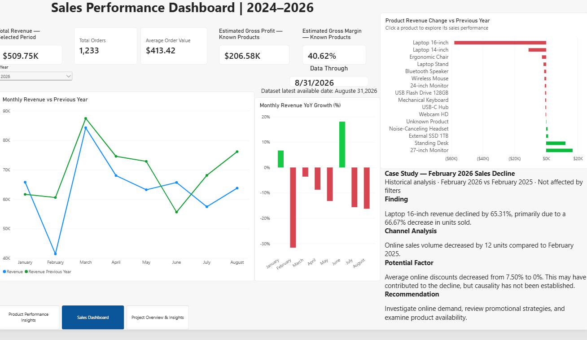
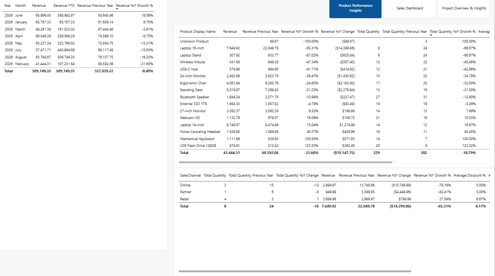

Sales Performance Analysis | Power BI

Project Overview

This project analyzes sales performance from 2024 through August 2026 using an interactive Power BI report.

The objective is to monitor key business metrics, identify sales trends, investigate revenue declines, and provide actionable business recommendations.

Tools & Skills

Power BI Desktop

Power Query (Data Cleaning and Transformation)

DAX Measures

Data Modeling

Data Visualization

Business Analysis

Key Performance Indicators

Revenue (Jan–Aug 2026): $509,749.35

Total Orders: 1,233

Average Order Value: $413.42

Estimated Gross Profit (Known Products): $206.58K

Gross Margin (Known Products): 40.62%

Key Findings

Revenue decreased by 8.49% in January–August 2026 compared with the same period in 2025.

February 2026 recorded a 31.60% year-over-year revenue decline.

Laptop 16-inch revenue decreased by $14,400.81.

Laptop 16-inch sales volume declined by 16 units, including 12 fewer units through the Online channel.

Average selling price for Laptop 16-inch increased from $918.74 to $956.24, while revenue still declined.

Report Pages

Product Performance Insights — Detailed analysis tables

Sales Dashboard — KPIs and interactive visualizations

Project Overview & Insights — Business findings and recommendations

Business Recommendations

Investigate the decline in Laptop 16-inch sales volume.

Review channel-level sales performance.

Evaluate pricing and promotional strategies without assuming causation.

Monitor revenue and profitability trends regularly.

Project Files

Power BI report files and dashboard screenshots will be added to this repository.

## Dashboard Screenshots

### 1. Sales Dashboard

### 2. Product Performance Insights

### 3. Project Overview & Insights

